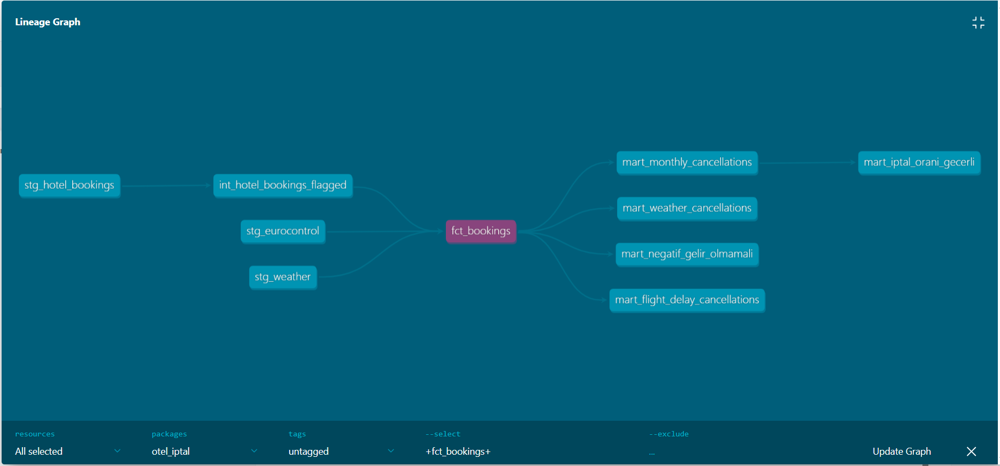
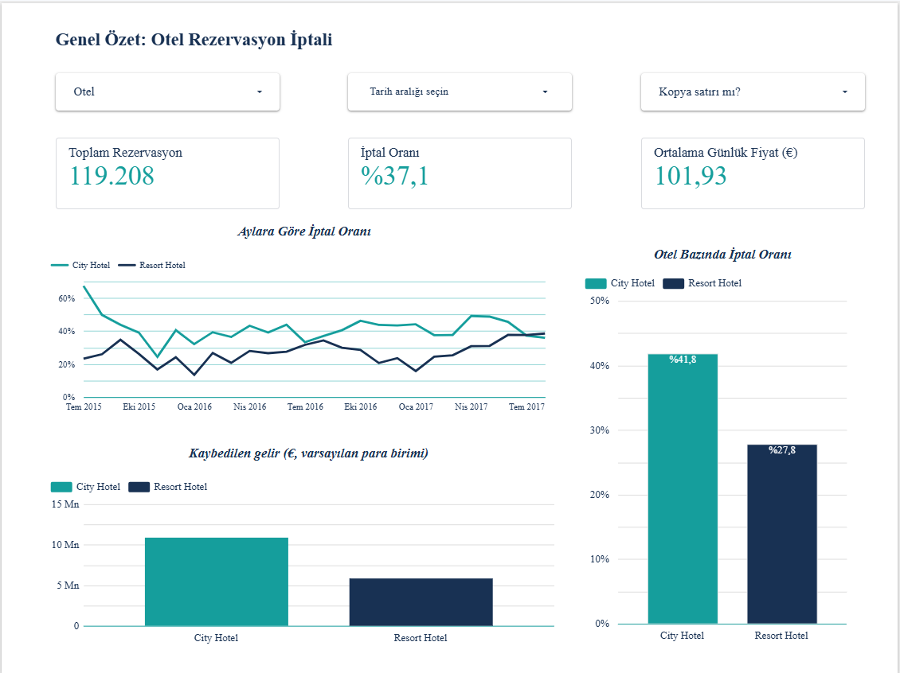
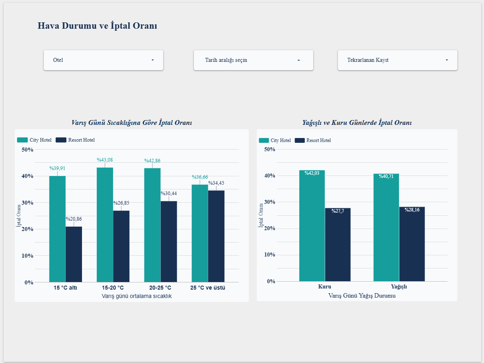
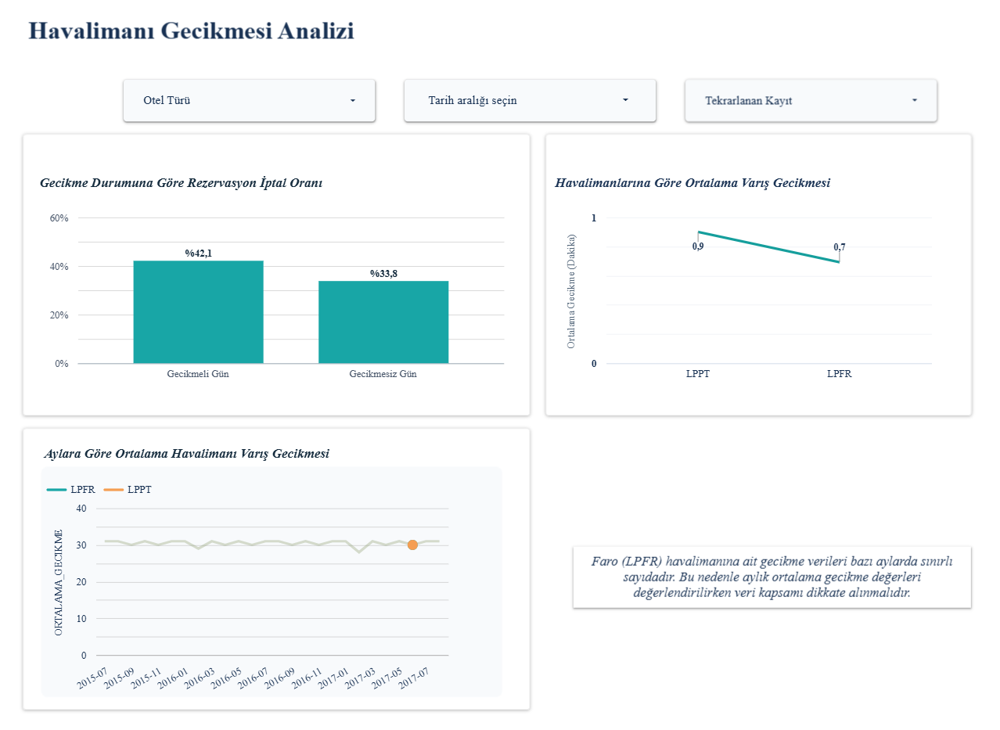

# Otel İptal Projesi: dbt Projesi

Kaggle "Hotel Booking Demand" verisini temizleyen, hava durumu ve havalimanı gecikme verisiyle birleştirip analize hazırlayan dbt (DuckDB) projesi.

## Veri kaynakları

| Kaynak | Dosya |
|---|---|
| Kaggle Hotel Booking Demand (119.390 rezervasyon, 2015-2017) | `data/raw/hotel_booking/hotel_bookings.csv` |
| Open-Meteo günlük hava durumu (Faro, Lizbon) | `data/raw/open_meteo/` |
| EUROCONTROL havalimanı gecikmeleri (2015-2017) | `data/raw/eurocontrol/` |

**Varsayım:** Veri setinde otel konumu yazmıyor. Resort Hotel'in Algarve'de (Faro), City Hotel'in Lizbon'da olduğu kabul edildi. Hava ve havalimanı verisi bu eşleştirmeyle bağlanıyor.

## Model katmanları

| Katman | Model | Ne yapar |
|---|---|---|
| staging | `stg_hotel_bookings` | Ham otel CSV'sini okur, temizler, tarih ve `booking_id` üretir |
| staging | `stg_weather` | Faro ve Lizbon günlük hava durumunu okur, otel ile eşleştirir |
| staging | `stg_eurocontrol` | Faro (LPFR) ve Lizbon (LPPT) havalimanı gecikmelerini okur |
| intermediate | `int_hotel_bookings_flagged` | Birebir aynı satırları `is_duplicate` ile işaretler |
| marts | `dim_date` | Tarih boyut tablosu |
| marts | `fct_bookings` | Rezervasyon, hava durumu ve havalimanı verisini birleştiren ana tablo |
| marts | `mart_monthly_cancellations` | Aylık iptal özeti |
| marts | `mart_weather_cancellations` | Hava durumuna göre iptal özeti |
| marts | `mart_flight_delay_cancellations` | Havalimanı gecikmesine göre iptal özeti |
| marts | `mart_airport_delays` | Havalimanı gecikme özeti |
| marts | `mart_yearly_delays` | Yıllık gecikme özeti |
| marts | `mart_airport_monthly_delay` | Havalimanı gecikmelerinin aylık özeti |

Staging, intermediate ve mart katmanları ayrı klasörlerdedir: `models/staging`, `models/intermediate`, `models/marts`.

## Çalıştırma

```
pip install dbt-duckdb
cd process/hotel_booking_cleaning
dbt run
dbt test
dbt docs generate
dbt docs serve
```

## dbt docs

Model ilişkileri ve sütun açıklamaları dbt docs ile görülebilir (`dbt docs generate`, `dbt docs serve`). `fct_bookings` modelinin akış şeması (lineage graph):



## Temizlik kararları (otel verisi)

| Karar | Gerekçe |
|---|---|
| `NULL` yazan hücreler gerçek boş değere çevrildi | Ham dosyada boş değerler metin olarak yazılmış |
| Yıl, ay adı ve günden `arrival_date` üretildi | Ham veride tarih üç ayrı sütunda |
| `booking_id` ham CSV'deki satır numarasıyla üretildi | Ham veride kimlik yok. Satır çıkarılsa bile numaralar değişmez |
| Boş `children` değerleri 0 yapıldı | 4 satırda boş, çocuk yok kabul edildi |
| `adr` negatif olan 1 satır çıkarıldı (rezervasyon 14970, -6,38) | Negatif günlük fiyat anlamsız |
| Yetişkin, çocuk ve bebek toplamı 0 olan 180 satır çıkarıldı | Misafirsiz rezervasyon anlamsız |
| `adr` değeri 1000'in üzerinde olan 1 satır çıkarıldı (5400) | Gerçek dışı fiyat, kaybedilen gelir toplamlarını şişiriyordu |
| Birebir aynı 32.238 satır silinmedi, `is_duplicate` ile işaretlendi | Kimlik sütunu olmadığı için gerçek kopya oldukları kesin değil |
| `reservation_status` ve `reservation_status_date` modelde kullanılmayacak | İptal sonucunu doğrudan ele verir (veri sızıntısı) |

Satır sayısı: 119.390 ham satırdan 1 negatif fiyatlı, 180 misafirsiz ve 1 uç fiyatlı satır çıkarılınca **119.208** satır kalır. İptal oranı tüm satırlarda %37,1, kopya işaretli satırlar çıkarılınca %27,3.

## Testler

`dbt test` ile çalışır, projede toplam **53 test** vardır ve hepsi geçer. Otel verisi için başlıca testler: `booking_id` benzersiz ve dolu, `hotel` iki değerden biri, `is_canceled` 0 veya 1 ve dolu, `arrival_date` dolu, negatif fiyat yok, misafirsiz rezervasyon yok. Hava durumu, Eurocontrol ve mart modellerinin testleri kendi şema dosyalarındadır.

## Belgeler

| Belge | Kapsam | Hazırlayan |
|---|---|---|
| [VERI_SOZLUGU_HOTEL_BOOKING.md](VERI_SOZLUGU_HOTEL_BOOKING.md) | Otel rezervasyon verisi | Esma Gül Polat |
| [VERI_SOZLUGU_WEATHER.md](VERI_SOZLUGU_WEATHER.md) | Hava durumu verisi | Zehra Aktaş |
| [VERI_SOZLUGU_EUROCONTROL.md](VERI_SOZLUGU_EUROCONTROL.md) | Havalimanı gecikme verisi | İrem Kızıltaş |
| [VERI_SOZLUGU_MARTS.md](VERI_SOZLUGU_MARTS.md) | Mart katmanı | Elif Uyar |

Model ve sütun açıklamaları `dbt docs generate` ile de görülebilir.

## Dashboard (Looker Studio)

Rapor: [https://datastudio.google.com/reporting/55dc2678-148c-459a-8ec7-e3a4e050e54b](https://datastudio.google.com/reporting/55dc2678-148c-459a-8ec7-e3a4e050e54b)

### Araç seçimi
Dashboard için Power BI yerine Looker Studio kullanıldı. Gerekçe: ücretsiz olması, tarayıcıdan çalışması, ekip üyelerinin aynı raporu eş zamanlı düzenleyebilmesi ve tek bağlantıyla paylaşılabilmesi.

### Veri kaynakları
dbt ile üretilen mart tabloları (`data/processed/marts/`) CSV olarak Looker Studio'ya yüklendi ve beş ayrı veri kaynağı olarak rapora bağlandı:

| Veri kaynağı | Kullanım |
|---|---|
| `mart_monthly_cancellations` | Genel özet: aylık ve otel bazlı iptal |
| `mart_weather_cancellations` | Hava durumu analizi |
| `mart_flight_delay_cancellations` | Havalimanı gecikmesi analizi |
| `fct_bookings` | Detay ve ek analizler (119.208 rezervasyon) |
| `dim_date` | Takvim boyutu |

### Ortak alanlar
- `iptal_orani` = `SUM(canceled_bookings) / SUM(total_bookings)`, yüzde türünde. Hazır `cancel_rate` sütununun toplamı veya ortalaması kullanılmaz, çünkü oranların ortalaması yanlış sonuç verir.
- `ay_baslangici`: aylık grafiklerde x ekseni olarak kullanılan tarih alanı.
- Ortalama günlük fiyat, aylık ortalamaların rezervasyon sayısıyla ağırlıklandırılmasıyla hesaplanır: `SUM(avg_adr * total_bookings) / SUM(total_bookings)`. Sonuç dbt ile birebir aynıdır (101,93).

### Rapor yapısı
Rapor üç sayfadan oluşur. Sayfalarda **hotel**, **tarih aralığı** ve **is_duplicate** filtreleri bulunur.

1. **Genel Özet:** toplam rezervasyon (119.208), iptal oranı (%37,1) ve ortalama günlük fiyat (101,93 €) kartları; aylara göre iptal oranı çizgi grafiği; otel bazında iptal oranı ve kaybedilen gelir (€, varsayılan para birimi) çubuk grafikleri. Rakamlar dbt sorgularıyla doğrulanmıştır.
2. **Hava Durumu:** varış günü sıcaklık bandına (15 °C altı, 15-20, 20-25, 25 °C ve üstü) ve yağışlı/kuru güne göre iptal oranı, otel bazında. Yağışlı ve kuru günler arasındaki fark küçüktür (City Hotel %42,0 ve %40,7; Resort Hotel %27,7 ve %28,2).
3. **Havalimanı Gecikmesi:** gecikme kaydı olan ve olmayan günlerde otel bazında iptal oranı, havalimanı bazında uçuş başına ortalama varış gecikmesi (dakika) ve aylık ortalama günlük toplam gecikme (dakika). Faro (LPFR) verisi seyrek olduğu için yorumlarken dikkatli olunmalıdır.

**Sayfa 1: Genel Özet**



**Sayfa 2: Hava Durumu**



**Sayfa 3: Havalimanı Gecikmesi**



### Paylaşım
Rapor sahibi Elif'tir. Takım üyeleri düzenleyici, bağlantıyı bilen herkes görüntüleyici yetkisine sahiptir.

### Bilinen sınırlar
- Veriler CSV anlık görüntüsüdür. Mart tabloları dbt ile yenilenirse CSV'ler Looker Studio'da yeniden yüklenmelidir.
- Hava durumu ve uçuş gecikmesi rezervasyon anında bilinmez. Bulgular nedensellik değil, ilişki gösterir.
- Havalimanı gecikmesi sayfasında "gecikme kaydı olan" günler neredeyse tamamen City Hotel'e aittir (Resort Hotel için yalnızca 389 rezervasyon). Bu yüzden otel dökümü olmadan yapılan karşılaştırma yanıltıcıdır. Aynı otel içinde gecikme ile iptal oranı arasındaki fark küçüktür (City Hotel: %42,3 ve %41,1).
- "Gecikme kaydı olmayan gün", gecikme olmadığı anlamına gelmez, o gün için EUROCONTROL'de kayıt bulunmadığı anlamına gelir.
- Aylık gecikme grafiği, yalnızca gecikme verisi bulunan günlerin ortalamasını gösterir. Faro'da çoğu ayda en fazla birkaç günlük veri vardır.
- `is_duplicate` filtresi tekrar eden kayıtları ayırmak içindir. Bu kayıtlar silinmemiş, işaretlenmiştir. Filtre boşken iptal oranı %37,1, kopyalar çıkarılınca yaklaşık %27,3'tür.

## Ekip ve görev dağılımı

| Kişi | Katkı (birinci aşama) |
|---|---|
| Esma | Otel rezervasyon verisi: dbt staging ve intermediate katmanları, temizlik kararları, testler, veri sözlüğü, bu README, dashboard Genel Özet sayfası |
| Zehra | Hava durumu verisi: `stg_weather`, testler, veri sözlüğü, dashboard Hava Durumu sayfası |
| İrem | EUROCONTROL verisi: `stg_eurocontrol`, havalimanı mart modelleri, veri sözlüğü, repo yönetimi, dashboard Havalimanı Gecikmesi sayfası |
| Elif | Mart katmanı (`dim_date`, `fct_bookings`, özet martlar), mart veri sözlüğü, dashboard kurulumu ve paylaşımı |

## Sınırlılıklar

- Kopya satırların gerçek kopya olup olmadığı veriden anlaşılamıyor.
- Otel konumu varsayıma dayanıyor (Resort Hotel = Faro, City Hotel = Lizbon).
- `adr` için para birimi veri setinde belirtilmemiş, Euro varsayıldı.
- Hava durumu (sıcaklık, yağış, rüzgâr) ve havalimanı gecikmesi varış gününe ait. Rezervasyon yapılırken bilinmiyor, bu yüzden iptal ile ilişkisi nedensel değil, ilişki olarak yorumlanmalı.
- Faro havalimanı için gecikme kayıtları seyrek.
- `reservation_status`, `reservation_status_date` ve onlardan türeyen gelir sütunları (`realized_revenue`, `lost_revenue`) iptal sonucunu ele verir. İkinci aşamadaki tahmin modelinde kullanılmamalı.